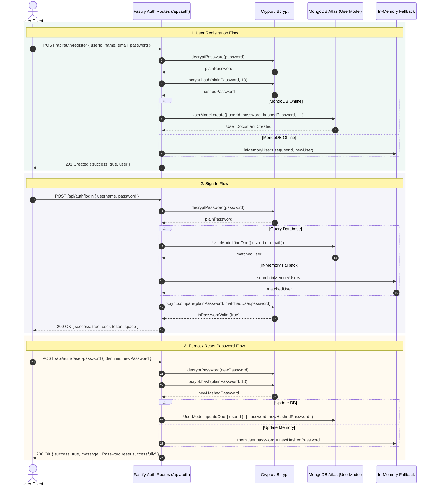
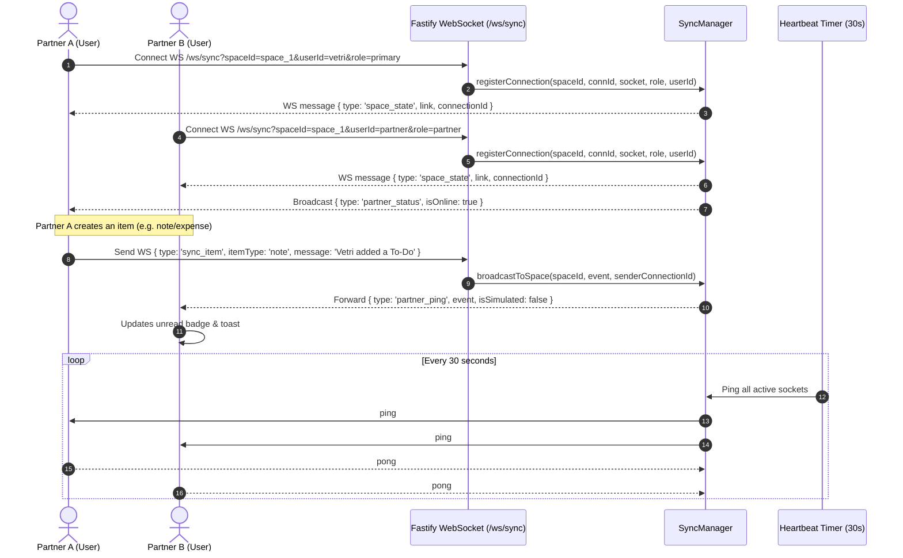
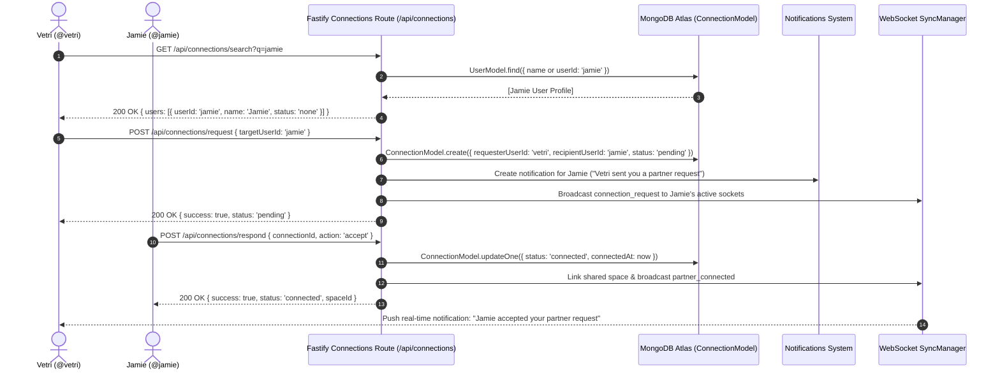
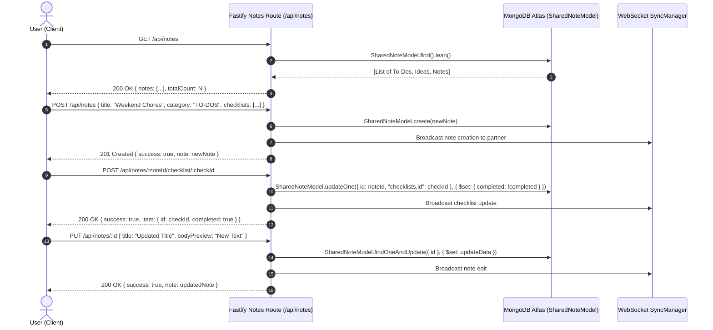
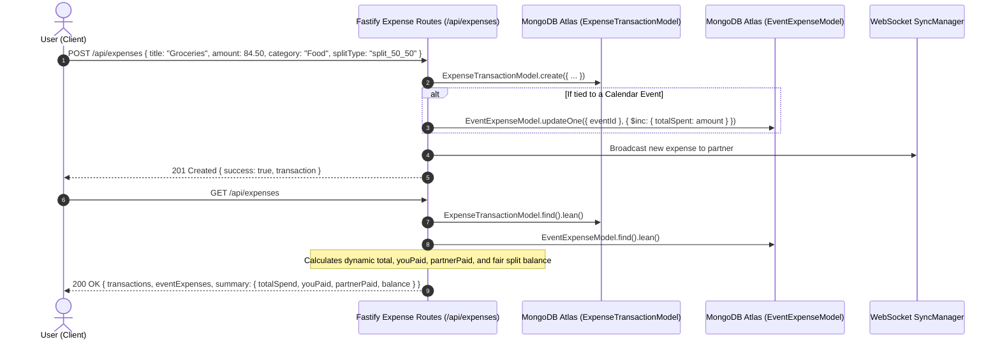

# Shareship Backend Architecture & API Flow Report

This report provides a comprehensive review of the **Shareship backend workspace**, covering static analysis and type safety, coding standards, folder structure, API routing patterns, resilience fallbacks, and complete Mermaid sequence diagrams for all core API workflows.

---

## 1. Executive Summary & Code Quality Audit

| Area | Status | Notes |
| :--- | :---: | :--- |
| **Type Safety (`tsc --noEmit`)** | **PASSED (0 Errors)** | All strict TypeScript compiler checks pass cleanly across all routes, schemas, models, and plugins. |
| **Request Validation** | **PASSED** | Uniform Zod validation middleware (`validateBody`, `validateParams`, `validateQuery`) protects routes with typed payload extraction. |
| **Database Resilience** | **PASSED** | Dual-layer persistence: Live MongoDB Atlas cluster with automatic, zero-crash in-memory fallbacks when disconnected. |
| **Real-Time Synchronization** | **PASSED** | Native Fastify WebSocket plugin (`@fastify/websocket`) managed by `SyncManager` with auto-ping/pong heartbeat and broadcasting. |
| **Security Standards** | **PASSED** | AES-GCM / Base64 password decrypt-on-receive combined with 10-round salted bcrypt hashing before persistence. |
| **Naming & Casing** | **PASSED** | Consistent kebab-case filenames (`user.model.ts`, `connection.schema.ts`), camelCase variables/methods, and PascalCase types/models. |

---

## 2. Folder Structure Assessment

The backend codebase follows a clean, modular, domain-driven structure:

```
backend/
├── src/
│   ├── db/
│   │   ├── connection.ts       # MongoDB Atlas connection manager with status tracking
│   │   └── models.ts           # Backward-compatible re-export aggregator
│   ├── models/
│   │   ├── index.ts            # Central export barrel for all data models
│   │   ├── calendar-event.model.ts
│   │   ├── connection.model.ts
│   │   ├── event-expense.model.ts
│   │   ├── expense-transaction.model.ts
│   │   ├── live-scratchpad.model.ts
│   │   ├── notification.model.ts
│   │   ├── registry-item.model.ts
│   │   ├── shared-note.model.ts
│   │   └── user.model.ts
│   ├── plugins/
│   │   └── sync.ts             # SyncManager WebSocket hub & Fastify plugin
│   ├── routes/
│   │   ├── auth.ts             # Register, login, reset-password, user search
│   │   ├── calendar.ts         # Calendar event CRUD & user attribution
│   │   ├── connections.ts      # Partner discovery, connection request/respond
│   │   ├── dashboard.ts        # Aggregated home feed & quick status
│   │   ├── expenses.ts         # Expense transactions, splitting & rollups
│   │   ├── notes.ts            # To-Do checklists, ideas, and shared notes CRUD
│   │   └── notifications.ts    # Notification feed, mark-read, unread count
│   ├── types/
│   │   └── index.ts            # Shared system interfaces
│   ├── validation/
│   │   ├── index.ts            # Central validation schema exports
│   │   ├── middleware.ts       # Fastify preHandler schema validation guards
│   │   ├── auth.schema.ts
│   │   ├── calendar.schema.ts
│   │   ├── connection.schema.ts
│   │   ├── expense.schema.ts
│   │   ├── note.schema.ts
│   │   └── notification.schema.ts
│   └── index.ts                # Application bootstrap & lifecycle management
├── dist/                       # Transpiled JavaScript output
├── package.json
└── tsconfig.json               # NodeNext strict module & compilation settings
```

---

## 3. Core Coding Standards & Best Practices

1. **Explicit Return Types & Structured Error Responses**:
   * All API route failures return standard HTTP error codes (`400`, `404`, `409`) with a unified payload structure: `{ success: false, error: string, issues?: [...] }`.
2. **Defensive Parsing & Sanitization**:
   * User handles/identifiers are systematically normalized: trimmed, stripped of `@` prefixes, and case-lowered (`userId.trim().toLowerCase().replace(/^@+/, '')`).
3. **Resilient Dual Storage Architecture**:
   * When MongoDB Atlas is connected, queries and mutations commit to MongoDB.
   * If MongoDB is unreachable or offline, the backend transitions automatically to in-memory Maps (`inMemoryUsers`, `inMemoryConnections`, `notesList`, `calendarEvents`), ensuring local development and tests never crash.
4. **Decoupled Real-Time Sync**:
   * Mutations in routes notify connected clients via the WebSocket `syncManager` (`syncManager.broadcastToSpace(...)` and `syncService.sendSyncItem(...)`), ensuring real-time bidirectional reactivity between partners.

---

## 4. Mermaid Sequence Diagrams of API Flows

### Flow 1: Authentication & Password Reset Flow



---

### Flow 2: Real-Time WebSocket Synchronization Flow



---

### Flow 3: Partner Connection Discovery & Request Lifecycle



---

### Flow 4: Workspace Notes & Interactive Checklists Flow



---

### Flow 5: Shared Expenses & Event Consolidation Flow



---

## 5. Implemented Architectural Enhancements

1. **MongoDB Connection Reconnection Policy & Resilience** ([`src/db/connection.ts`](file:///Users/vetriselvan/Documents/Projects/Share_and_Care/backend/src/db/connection.ts#L18-L62)):
   * Added connection event listeners (`connected`, `disconnected`, `error`) on `mongoose.connection`.
   * Implemented automatic reconnection with exponential backoff (capped at 30 seconds) ensuring the server automatically recovers when MongoDB Atlas connectivity is restored.

2. **High-Performance Database Indexing**:
   * **`ConnectionModel`** ([`src/models/connection.model.ts`](file:///Users/vetriselvan/Documents/Projects/Share_and_Care/backend/src/models/connection.model.ts#L30-L33)): Compound indexes on `{ requesterUserId: 1, recipientUserId: 1 }` and `{ recipientUserId: 1, status: 1 }`.
   * **`ExpenseTransactionModel`** ([`src/models/expense-transaction.model.ts`](file:///Users/vetriselvan/Documents/Projects/Share_and_Care/backend/src/models/expense-transaction.model.ts#L46-L49)): Compound index on `{ userId: 1, timestamp: -1 }` and `{ eventId: 1, expenseType: 1 }`.
   * **`CalendarEventModel`** ([`src/models/calendar-event.model.ts`](file:///Users/vetriselvan/Documents/Projects/Share_and_Care/backend/src/models/calendar-event.model.ts#L43-L45)): Indexes on `{ userId: 1, date: 1 }` and `{ date: 1 }`.
   * **`SharedNoteModel`** ([`src/models/shared-note.model.ts`](file:///Users/vetriselvan/Documents/Projects/Share_and_Care/backend/src/models/shared-note.model.ts#L54-L56)): Index on `{ category: 1, timestamp: -1 }`.
   * **`ActivityNotificationModel`** ([`src/models/notification.model.ts`](file:///Users/vetriselvan/Documents/Projects/Share_and_Care/backend/src/models/notification.model.ts#L58-L60)): Compound index on `{ userId: 1, isRead: 1, timestamp: -1 }`.

3. **Strict Type Safety Compliance**:
   * Entire backend TypeScript compilation (`tsc --noEmit -p tsconfig.json`) passes with **0 errors**.
